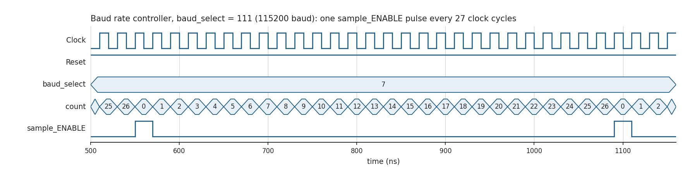
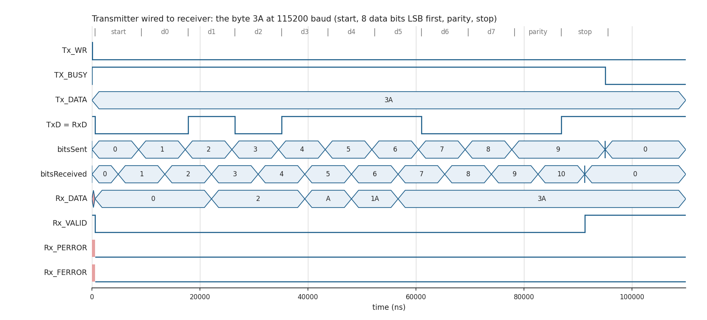
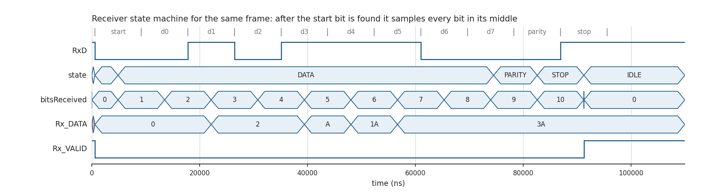
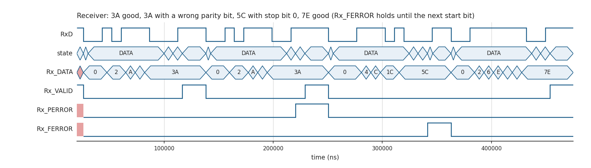
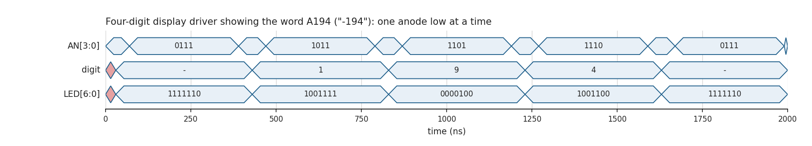
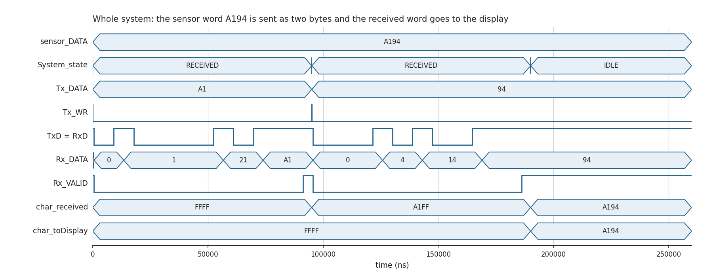
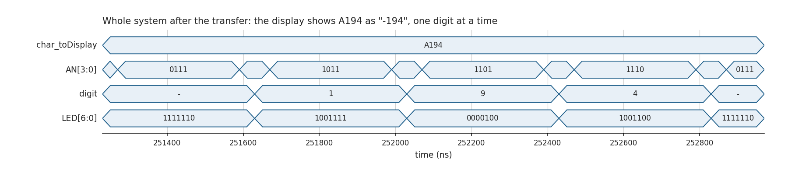

# Design notes

How the UART transmitter, receiver and four-digit display work, with waveforms from the simulation. All figures in this folder were produced by simulating the code in this repository with Icarus Verilog 12.0; the design was only simulated, not run on an FPGA board.

The clock is 50 MHz (a 20 ns period in the testbenches).

## System overview

The top module `System` (`design.sv`) takes a 16-bit "sensor word", sends it as two bytes through a UART transmitter, receives the bytes with a UART receiver, and shows the received word on a four-digit seven-segment display.

| Module | File | Job |
|---|---|---|
| `System` | `design.sv` | Top level: sends the high byte, then the low byte, collects them, drives the display |
| `uart_transmitter` | `uart_transmitter.v` | Serialises one byte into a frame |
| `uart_receiver` | `uart_receiver.v` | Recovers a byte from a frame, flags parity and framing errors |
| `baud_controller` | `baud_controller.v` | Produces the sample tick for the chosen baud rate (one instance in each of the transmitter and receiver) |
| `driving_4_anodes` | `driving_4_anodes.v` | Shows four hex digits by switching the anodes one after another |
| `LEDdecoder` | `LEDdecoder.v` | Turns a 4-bit value into the seven segment lines |

Inside `System` the transmitter's `TxD` output is wired straight to the receiver's `RxD` input, so the word travels over a real serial frame format but never leaves the chip. `System` fixes the baud rate at `baud_select = 111` (115200 baud).

## Baud rate controller

The controller counts clock cycles and emits a one-cycle pulse, `sample_ENABLE`, every N+1 clock cycles. Transmitter and receiver both work on a 16x oversampled tick: one bit lasts 16 sample ticks.

`baud_select` chooses the terminal count. Measured in simulation (sample period in clock cycles, the baud rate that period implies with a 50 MHz clock and 16x oversampling, and the error against the nominal rate):

| `baud_select` | Nominal baud | Terminal count | Sample period (cycles) | Implied baud | Error |
|---|---|---|---|---|---|
| 000 | 300 | 10416 | 10417 | 300 | 0.00 % |
| 001 | 1200 | 2604 | 2605 | 1200 | -0.03 % |
| 010 | 4800 | 651 | 652 | 4793 | -0.15 % |
| 011 | 9600 | 325 | 326 | 9586 | -0.15 % |
| 100 | 19200 | 163 | 164 | 19055 | -0.76 % |
| 101 | 38400 | 81 | 82 | 38110 | -0.76 % |
| 110 | 57600 | 53 | 54 | 57870 | +0.47 % |
| 111 | 115200 | 26 | 27 | 115741 | +0.47 % |

All errors are well inside what a UART tolerates, and transmitter and receiver use the same divider, so they stay in step.

## Frame format

One frame carries one byte:

1. a start bit (line low),
2. eight data bits, least significant bit first,
3. a parity bit, equal to the XOR of the eight data bits (so the data plus parity bit always hold an even number of ones),
4. a stop bit (line high).

The line idles high. The figure shows the byte `3A` (`0011 1010`) crossing from transmitter to receiver at 115200 baud: low start bit, data bits 0, 1, 0, 1, 1, 1, 0, 0, parity 0 (four ones), stop bit 1. One frame takes 11 bit times of 8.64 µs, about 95 µs.

## Transmitter

The transmitter has five states: `IDLE`, `START`, `DATA`, `PARITY` and `STOP`. The caller puts a byte on `Tx_DATA` and raises `Tx_WR`; the transmitter raises `TX_BUSY` and lowers it again after the stop bit. `TX_EN` enables the transmitter. `TxD` changes once every 16 sample ticks.

## Receiver

The receiver watches `RxD` while idle. When the line goes low it moves to `START`, waits eight sample ticks to reach the middle of the start bit, and from then on samples one bit every 16 ticks, so each bit is read in its middle.

Outputs:

- `Rx_DATA`: the byte, written bit by bit as the frame arrives (the figure shows it filling up from bit 0);
- `Rx_VALID`: low while a frame is being received, high again after the stop bit was read as 1;
- `Rx_PERROR`: set when the received parity bit differs from the XOR of the received data bits, decided at the parity bit;
- `Rx_FERROR`: set when the stop bit reads 0.

After a stop bit of 0 the receiver goes to a `BREAK` state and waits until the line is high again before looking for the next start bit. `Rx_FERROR` therefore stays set until the next start bit begins, and `Rx_VALID` stays low for that frame.

The next figure drives the receiver with four frames: a good one, one with a wrong parity bit (`Rx_PERROR` rises; `Rx_VALID` is still 1, because the stop bit was fine), one with stop bit 0 (`Rx_FERROR` rises and is held until the next start bit), and a good one, which is received correctly.

## Display

`LEDdecoder` maps a 4-bit value to the seven segments, active low:

| Value | Shown |
|---|---|
| 0 to 9 | the digit |
| A | "-" |
| B | "F" |
| C to F | blank |

`driving_4_anodes` shows four such digits (16 bits) on the four-digit display. It pulls one anode low at a time, in the order `0111`, `1011`, `1101`, `1110` (leftmost digit first), each for 320 ns, with a gap of 80 ns with all anodes high between digits. A full scan takes 1.6 µs, and the anodes never overlap. The segment lines change to the next digit during the gap.

## Whole system

The sensor word `A194` (shown as "-194") is split into the bytes `A1` and `94`. The figure shows both frames on `TxD`, the receiver's `Rx_DATA` filling up, `char_received` becoming `A1FF` after the first byte and `A194` after the second, and `char_toDisplay` taking the word. In the simulation the word reaches the display about 187 µs after reset.

After the transfer the display scans the four digits continuously:

If the receiver reports a parity or framing error, `System` replaces the word by `BBBB`, which the decoder shows as "FFFF". Because `TxD` is wired directly to `RxD` inside `System`, this path is not exercised by the system testbench; the receiver's error outputs are checked on their own (see below).

## Tests

`bash run_sim.sh` compiles and runs everything with Icarus Verilog (`STD=2005 bash run_sim.sh` for Verilog-2005; the system check needs SystemVerilog and is skipped then). Each check prints `CHECK_PASS` or `CHECK_FAIL`:

| Check | What it verifies |
|---|---|
| `system_display` | Runs the project's `System_TB`: the anodes never overlap and are each low for 320 ns, the segment pattern matches the decoder for each digit, and the word on the display equals the sensor word |
| `uart_loopback` | Transmitter wired to receiver at all eight baud rates, four words each (`3A`, `A5`, `FF`, `00`): data correct, `Rx_VALID` high, no error flags |
| `rx_parity_error` | Good frames and frames with a wrong parity bit, including wrong frames whose parity bit equals the previous frame's: `Rx_PERROR` is set exactly for the wrong ones |
| `rx_framing_error` | A frame with stop bit 0: `Rx_FERROR` is set and held, `Rx_VALID` stays low, and the next good frame is received correctly |
| `baud_rates` | The sample period for every `baud_select` gives the table's baud rate within 2 % |

The three component testbenches (`baud_controller_TB.v`, `driving_4_anodes_TB.v`, `uart_transmitter_receiver_TB.v`) only declare the module under test and its stimulus; they take `clk_TB` and `reset_TB` as ports and are meant to be instantiated from a testbench that supplies the clock and reset, as `testbench.sv` does in its commented-out lines. The figures above were made that way.

## Limits

- Simulation only. The design was not synthesised and not run on hardware.
- Reset is modelled as an asynchronous active-low signal that must have a falling edge (from unknown to 0, as in `testbench.sv`) to put the state machines in their idle state.
- The optional encoder/decoder part of the assignment is not implemented.
